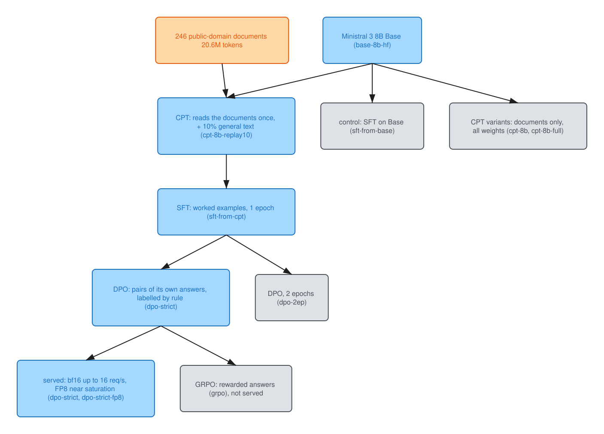
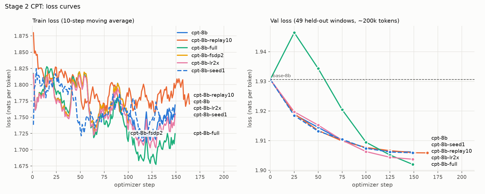
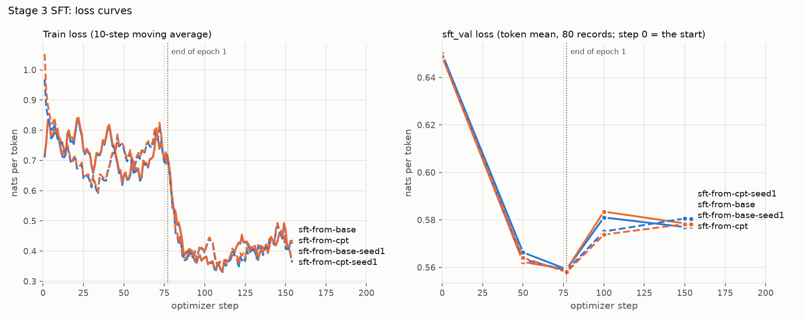
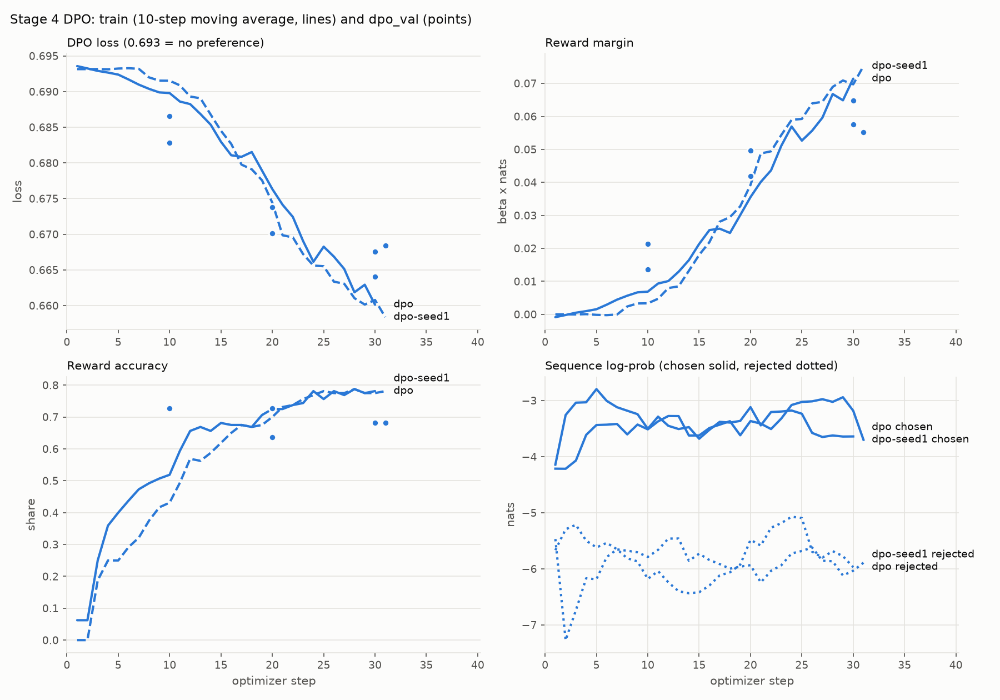
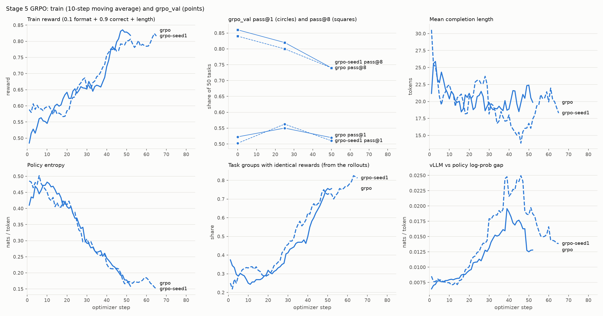

# struct-lm

> Independent project, using only public documents, open weights and open-source tools.

This project takes a small open-weight language model, Mistral's **Ministral 3 8B** (8 billion
parameters), and adapts it to one technical field: US federal structural-engineering documents.
These are design manuals, standards and reports published by the Army Corps of Engineers (USACE),
FEMA, the Federal Highway Administration (FHWA), NIST and NASA. The model goes through the four
usual training steps, and is then compressed and served:

1. **Continued pre-training (CPT):** the model reads the documents.
2. **Supervised fine-tuning (SFT):** it studies worked examples of questions and answers.
3. **Preference training (DPO):** it is shown pairs of its own answers, one right and one wrong.
4. **Reinforcement learning (GRPO):** it answers questions and is rewarded when a checker marks
   the answer right.
5. **Serving:** the model is compressed to fewer bits per number and tested for quality and speed.

Every step is compared with the untouched model (**Base**) and with Mistral's own chat version of
the same model (**Instruct**). Each training section below says what the step does, shows one
real example of its training data, explains how its training works, and gives all its scores and
its training curves. Each section ends with a link to its full write-up in `docs/`, which has more
detail; some of its figures split a measure differently (for example, a log-probability that
includes the end-of-answer token). The rules for reading each step's results (the noise floor,
which checkpoint to keep, when to stop) were written down before the step ran. Every later
change, with its date, is listed at the top of [`notes/decisions.md`](notes/decisions.md), and
the ones that bear on a result are noted where that result appears.

## In brief

- **When given the right passages, stock Instruct already answers about as well as the tuned
  model.** A judge marks 92.6% of the served model's answers correct and 89.8% of Instruct's.
- **Tuning changed how the model answers.** The served model cites only passages it was given
  (100% of the time, against Instruct's 83.3%) and never refuses a question the passages answer
  (Instruct refuses 7.4%).
- **It learned the facts it was fine-tuned on.** With no passages, it answers 28.7% of questions
  on those facts after SFT, against Instruct's 11.4%.
- **Reading the documents taught it little it could recall.** On facts that appear only in the
  documents, it scores 11.6% after SFT, the same as the untrained Base; fine-tuning without reading
  first drops that to 8.4%. Reading made the right answers more probable to the model, but rarely
  probable enough to become its answer. Questions answered by a document or section number are the
  exception: reading improved those.
- **Preference training and reinforcement learning didn't reliably improve accuracy or behaviour
  beyond the noise.** Both made a right answer more likely to come up when the model's answer is drawn
  at random, and both made the right answers to document-only facts less probable. The
  reinforcement-learning model was not served.
- **Compressing the model's numbers to 8 bits (FP8) changed no score beyond the noise.** Also
  compressing its memory of the conversation to 8 bits lowered one score, and compressing the
  numbers to 4 bits (INT4) lowered several.

The main models side by side. "Taught" facts are those the fine-tuning data covers, and
"document-only" facts are the rest. The log-probability column measures how likely the model finds
the right answer (closer to zero is better). ↓ marks a measure where lower is better. **[base
format]** means the model was tested as a base model (a plain-text prompt rather than a chat), so
its log-probability doesn't compare with the other rows'. The last row is the noise floor:
differences smaller than it are treated as noise. The next section explains each.

<!-- headline-summary:start -->
| run | what it is | closed-book, taught (%) | closed-book, document-only (%) | gold-answer log-prob, document-only | grounded correct (%, judge) | unanswerable answered (%) ↓ | GSM8K (%) |
|---|---|---|---|---|---|---|---|
| `base-8b-hf` | Ministral 3 8B Base [base format] | 12.6 | 11.6 | -6.36 | 84.3 | 89.5 | 79.3 |
| `instruct-8b` | Ministral 3 8B Instruct | 11.4 | 7.7 | -7.71 | 89.8 | 1.3 | 85.5 |
| `sft-from-base` | SFT on Base (control) | 24.0 | 8.4 | -6.20 | 92.6 | 6.6 | 79.2 |
| `sft-from-cpt` | CPT → SFT | 28.7 | 11.6 | -5.89 | 90.7 | 5.3 | 81.4 |
| `dpo-strict` | CPT → SFT → DPO (served) | 30.5 | 11.0 | -6.27 | 92.6 | 3.9 | 80.9 |
| `grpo` | CPT → SFT → DPO → GRPO (not served) | 29.9 | 9.7 | -7.54 | 93.5 | 1.3 | 82.0 |
|  | *floor, chat rows: gap between two SFT seeds, or the standard error* | 3.5 | 2.6 | 0.21 | 2.8 | 3.9 | 2.2 |
<!-- headline-summary:end -->



*Blue: the line that was served. Grey: other runs, for comparison. The names in brackets are the
run names in the tables; `base-8b-hf` is the Base re-saved in the same file format as the trained
models, so that all of them load the same way.*

## Words used here

| word | meaning |
|---|---|
| token | a word or piece of a word; models read and write text one token at a time |
| weights | the billions of numbers inside the model; training adjusts them, and "frozen" weights are left as they are |
| LoRA adapter | a small set of extra weights trained on top of frozen ones (its "rank", 64 here, sets its size); "merging" adds it into the main weights for serving |
| loss | a score of how wrong the model's guesses are; training lowers it. Training loss is measured on the examples being trained on, validation loss on held-out examples it never trains on, which shows whether it is learning or just memorising |
| epoch | one pass over all the training data |
| seed | the number that fixes training's random choices; two "twin" runs differ only in their seed |
| temperature | how much randomness the model uses when picking each token: 0 always takes the most likely one, and higher values give more varied answers |
| log-probability, nats | how likely the model finds an answer, on a logarithmic scale (natural log, in "nats"); closer to zero is more likely |
| perplexity | how surprised the model is by a text; lower means it predicts the text better |
| standard error, confidence interval | how much a score could move if the test questions were redrawn; a 95% confidence interval is the range it would likely fall in, and "paired" means two models are compared question by question |
| start-of-text token | a special token that marks the start of a text; many models expect it |
| judge | a large model asked to grade an answer |
| bf16, FP8, INT4 | ways of storing the model's numbers: bf16 is the format it was trained in, FP8 uses half as many bits per number and INT4 a quarter; fewer bits make the model smaller and faster but less precise |
| KV cache | the model's memory of the conversation so far |
| H100, Modal | the GPU (graphics chip) that ran everything, rented from the cloud service Modal |

## How the model was tested

**The domain test:** 716 questions written by Mistral Large 3, a much larger Mistral model, from
passages of the documents. Each was checked against its source passage before any model answered
it. There are four kinds:

| kind | questions | the model gets | it is right if |
|---|---|---|---|
| closed-book | 322 | the question alone | its answer matches the source's, checked by rule |
| grounded | 108 | the question and four passages, one of which holds the answer | the answer is correct (judged); its citations are scored separately |
| definitions | 210 | a domain term | its definition matches the source's (judged) |
| unanswerable | 76 | a question the four passages don't answer | it declines, rather than making an answer up |

An example closed-book question, from the passage quoted in the CPT section below:

```text
Q: What document provides dimensional data, weights, and truck reactions for cranes in
   Corps of Engineers powerhouses?
gold answer: EM 1110-2-4203
```

**How answers are scored:**
- **By rule,** where a rule can decide. A closed-book answer must match the whole correct ("gold")
  answer after tidying spacing, case and units, with numbers allowed within 2%. This is the strict
  checker; it replaced an earlier, more lenient one ([`docs/verifiers.md`](docs/verifiers.md) has
  both). A citation must name one of the given passages, and the fixed sentence "Not in the
  provided passages." counts as declining.
- **By a judge,** where no rule can: Mistral Large 3, set to answer the same way every time
  (temperature 0), decides whether a grounded answer or a definition is correct, and whether any
  other reply to an unanswerable question answers it anyway. It sees the source passage and
  answers one yes-or-no question per answer. Its verdicts were spot-checked by hand, but it was
  never formally benchmarked, so the judged columns carry more uncertainty than the rule-checked
  ones. The same model, prompted to rank several answers at once, was also tried as a labeller of
  training data, and missed most known flaws (see DPO).

**Taught and document-only facts.** Before fine-tuning, the closed-book questions were split in two
by source passage. For the **taught** half (167 questions), the fine-tuning data may use the same
passages, and for 121 of the 167 it asks the same fact in other words; it never contains a test
question itself. The **document-only** half (155 questions) comes from passages kept out of every
later training set, so the model could learn those facts only by reading the documents in CPT.
**Document and section numbers** are the 64 closed-book questions, from both halves, whose answer
is a document or section number, such as EM 1110-2-4203. The closed-book set grew from 130 to 322
items after continued pre-training; the new items were checked before any model answered them,
and every model whose weights still existed was re-run on the larger set.

**For reference,** Mistral Large 3 itself answers 26.3% of the taught half and 25.8% of the
document-only half with no passages (run through Mistral's API, closed-book only).

**General benchmarks,** to see whether the model forgets general skills: MMLU (multiple-choice
questions on general knowledge), GSM8K (grade-school maths word problems) and HellaSwag (picking the
sensible ending of a sentence). Each prompt includes 5 solved examples, and all run with
EleutherAI's lm-evaluation-harness, the standard tool. They ran without the chat format and
without a start-of-text token, so the scores compare with each other but not with published ones.

**Three more measures:**
- **Perplexity:** how surprised the model is by text it hasn't trained on; lower is better. It is
  measured on held-out document text and on general web text (FineWeb-Edu).
- **Gold answer's log-probability:** the model gives every possible answer a probability. This is
  the natural logarithm of the probability it gives the correct answer's own tokens, in units
  called nats. Closer to zero is better, and each extra nat makes the answer e times (nearly three
  times) as likely. It moves before accuracy does, so it shows learning too small to change which
  answer the model gives. The full tables also show the end-of-answer token's log-probability, in
  separate columns.
- **Sampled accuracy:** the model normally gives its single most likely answer. Sampled accuracy
  instead draws 8 answers at random from its probabilities (temperature 0.7) and counts how many
  are right on average, so it shows right answers becoming more likely before they become the top
  choice. It is a measure added after the fact, once DPO's results were in.

**The noise floor.** Training has randomness, so the same recipe run twice gives slightly
different scores. Twin runs were trained for CPT on documents only, for SFT from both starting
points, for the first DPO runs and for GRPO; the CPT run used next and the served DPO run were
trained once. A difference counts only if it is larger than the noise floor: the gap between a
pair of twins, or the measure's standard error if that is larger. One floor serves each kind of
model. For models tested as base models (Base and CPT) it comes from the CPT twins; for every chat
model (Instruct, SFT, DPO, GRPO and the compressed versions) it comes from the SFT twins. The DPO and
GRPO twins are shown in their tables for comparison. The floor is about one standard deviation, so
it is a screen, not a proof. With 155 to 167 questions per half, it comes to 2.6 to 3.5 points on
closed-book accuracy, so smaller gains can't be seen. Floors and gaps are compared before rounding,
so a gap read off the rounded tables can differ from it in the last digit. The statements below compare single
runs unless they say they use both twins.

## The documents

251 candidate PDFs from the five agencies, all US-government works and so in the public domain.
Copyrighted standards the documents cite (ASCE 7, the AISC steel manual) were left out. The text
was extracted, cleaned of table fragments, contents pages, reference lists and garbled scans,
deduplicated, and scrubbed of personal data. That left 246 documents and 20.6M tokens (a token is
a word or part of a word), of which 19.4M form the training split; the rest is held out for
testing.

The cleaning also removed some test answers. Of the 138 document-only closed-book answers that
appear word for word in their source passage, 5 are missing from the cleaned text CPT read, and
so are 4 of the 150 on the taught half; all 9 were in the extracted text and went with the
paragraphs around them (mostly tables, lists and reference entries). The other 17 answers in each
half don't appear word for word in their passage, so this check can't cover them
([`results/cpt_coverage.json`](results/cpt_coverage.json)).

**Overlap checks** (GPT-3's method): no GSM8K or HellaSwag question shares any run of 13 tokens
with the training text, and 21 of 14,042 MMLU questions do, all through stock phrases. No test
question was copied into the SFT, DPO or GRPO data
([checks](docs/stage1.md#contamination-checks)). Full write-up: [`docs/stage1.md`](docs/stage1.md).

## Continued pre-training (CPT)

**What it is:** the model keeps doing what it learned to do in pre-training, guessing the next
token, but now on the documents. It read the training split once, with 10% general web text
(FineWeb-Edu) mixed in to keep its general skills.

**Training data sample:** plain document text. This excerpt is from EM 1110-2-3001, *Planning and
Design of Hydroelectric Power Plant Structures* (USACE):

```text
Dimensional data, weights, and truck reactions for cranes installed in Corps of Engineers
powerhouses are given in EM 1110-2-4203. An impact allowance of 10 percent for cranes over
80-ton capacity, and from 12 percent to 18 percent for smaller cranes, should be added to the
static loads. Side thrust at the top of the rail should be taken as 10 percent of the summation
of the trolley weight and rated capacity, with three-fourths of this amount distributed equally
among the wheels at either side of the runway.
```

**How training works:**
- **What the model sees:** the documents' plain text, cut into windows of 4,096 tokens (a few pages
  each).
- **What it learns from:** at every position it guesses the next token, and training nudges the
  weights so the actual next token becomes a little more likely. There are no labels: the text is
  its own answer key.
- **What gets trained:** a small add-on to the model (a LoRA adapter, rank 64) on top of the frozen
  original weights, on one H100 GPU. One variant trained all the weights instead, on two GPUs.
- **One training step:** 32 windows at a time. One pass over the data took 164 steps.

**Scores:**

<!-- step-cpt:start -->
| measure | Base | CPT + 10% general text (used next) | CPT, documents only | CPT, documents only, seed 1 | CPT, all weights | noise floor |
|---|---|---|---|---|---|---|
| closed-book, taught facts (%) | 12.6 | 15.0 | 15.6 | 13.2 |  | 2.8 |
| closed-book, document-only facts (%) | 11.6 | 11.0 | 13.5 | 12.9 |  | 2.7 |
| closed-book, document and section numbers (%) | 7.8 | 12.5 | 12.5 | 12.5 |  | 4.1 |
| gold answer's log-probability, taught facts (nats) | -6.28 | -5.93 | -5.84 | -5.84 |  | 0.03 |
| gold answer's log-probability, document-only facts (nats) | -6.36 | -5.70 | -5.68 | -5.70 |  | 0.03 |
| grounded: answer correct (%, judge) | 84.3 | 77.8 | 83.3 | 79.6 | 88.9 | 3.7 |
| grounded: citations name only given passages (%) | 12.0 | 5.6 | 14.8 | 10.2 | 14.8 | 4.6 |
| grounded: cited passages support the answer (%, judge) | 8.3 | 3.7 | 7.4 | 3.7 | 10.2 | 3.7 |
| grounded: answerable question declined (%) ↓ | 0.9 | 0.0 | 0.0 | 0.0 | 0.0 | 0.0 |
| unanswerable: answered anyway (%) ↓ | 89.5 | 93.4 | 90.8 | 93.4 | 92.1 | 3.3 |
| definitions correct (%, judge) | 70.5 | 70.0 | 71.0 | 70.0 | 74.3 | 3.1 |
| MMLU (%) | 76.7 | 76.6 | 76.4 | 76.5 | 76.2 | 0.3 |
| GSM8K (%) | 79.3 | 79.1 | 78.5 | 78.6 | 76.3 | 1.1 |
| HellaSwag (%) | 80.1 | 80.0 | 80.1 | 80.0 | 79.8 | 0.4 |
| perplexity, held-out document text ↓ | 6.88 | 6.72 | 6.72 | 6.72 | 6.73 | 0.02% |
| perplexity, general web text ↓ | 8.15 | 7.97 | 8.18 | 8.17 | 8.25 | 0.23% |

- The floor is the gap between the two documents-only seeds, or the standard error if larger; perplexity's floor is that gap as a % change.
- 'Taught' names the half of the closed-book questions that SFT later covers: at this step neither half has been taught.
- CPT, all weights has no closed-book numbers: its weights were deleted before the closed-book set grew, and a run that trains every weight can't be rebuilt from a small saved adapter the way the other runs can.
<!-- step-cpt:end -->

**What it found:**
- **Perplexity on held-out document text fell 2.33%** (6.88 to 6.72), and the right answers to
  closed-book questions became more probable (the log-probability rows, far beyond the floor).
- **Closed-book accuracy barely moved.** For the run used next, taught facts went from 12.6% to
  15.0% and document-only facts from 11.6% to 11.0%, both within the floor. Of the two
  documents-only twins, one rose beyond the floor on taught facts (15.6%) and the other didn't
  (13.2%). Reading made the text familiar, but mostly didn't make the model able to recall it. A
  few answers were never in the text it read (5 of the 138 checkable document-only ones; see The
  documents).
- **Document and section numbers are the exception:** all three LoRA runs answered 12.5% of them,
  against Base's 7.8%, beyond the 4.1-point floor.
- **With passages, the CPT models did worse than Base** (tested as base models, which don't cite
  well before SFT). The run used next got 7 fewer of the 108 grounded questions right and cited
  validly on 7 fewer, and answered 3 more of the 76 unanswerable questions, all beyond the floor. SFT later
  set this behaviour anew.
- **General skills mostly held:** for the run used next, MMLU, GSM8K and HellaSwag stayed within the
  floor, and the documents-only run's MMLU dropped just past it (76.4% against 76.7%). General-text
  perplexity rose 0.40% without the general text mixed in (beyond the 0.23% floor) and fell 2.24%
  with it.

**Choices:**
- **10% general text, kept though the evidence for it is thin.** Against the documents-only run it
  scored 0.2 points higher on MMLU, inside MMLU's 0.34-point standard error, and it lowered
  general-text perplexity, measured on the same kind of web text it was trained on. With it,
  grounded accuracy was 6.5 points below Base's (floor 3.7), lower than either documents-only twin.
  It was kept because it adds only 10% more tokens, and after SFT the grounded scores of the two
  starting points are within the floor of each other on average over their twins.
- **A small add-on (LoRA), not training all the weights.** The all-weights run (two GPUs, one run)
  gained about as much on held-out text but memorised more: perplexity on its own training text
  fell 22%, against LoRA's 8%. It lost more general skill: general-text perplexity rose 1.19%
  (LoRA's: 0.40%), GSM8K fell 3.0 points (floor 1.1) and MMLU fell to 76.2% from 76.7%. Its grounded
  and definition scores rose beyond the floor (88.9% and 74.3%, against 84.3% and 70.5%).



*Training loss (a moving average) and validation loss, the loss on held-out text: validation loss
flattens by the end of the one pass.*

Full write-up: [`docs/stage2.md`](docs/stage2.md).

## Supervised fine-tuning (SFT)

**What it is:** training on example conversations, a question and the answer the model should
give, so it learns to answer in the test's formats. The training set has 2,436 examples:
- **1,778 domain examples** (closed-book, grounded and definition), written by Mistral Large 3 and
  Mistral Medium 3.5 from the documents' passages (Medium 3.5 wrote 415). Each was checked by rule,
  by the judge, and by reading it in full against its passage (Claude did these reads, with
  keep-or-drop verdicts only).
- **183 refusals** for unanswerable questions, all the one fixed sentence.
- **475 general examples** from AI2's Tülu 3 instruction mixture, to keep general chat skills (500
  were drawn, and the other 25 went to the validation set).

SFT was run from two starting points: the CPT model (the line that was served), and the Base, as a
control that shows what CPT added.

**Training data sample:** one domain example, on the passage above (from
`data/sft/hosted/train.jsonl`):

```text
user:      Short answer only, please: When assessing crane runways in hydroelectric power
           plants, what percentage of the total trolley weight plus rated capacity must be
           factored in as side thrust at the rail top?
assistant: 10 percent
```

**How training works:**
- **What the model sees:** a question and the answer we want it to give, laid out in the chat
  format the model uses (the same layout as the test's prompts).
- **What it learns from:** the model reads the answer one token at a time and, at each point,
  guesses the next one. Training nudges the weights so the right next token becomes a little more
  likely. Only the answer's tokens count; the question is there as context.
- **What gets trained:** a new LoRA adapter (rank 64) on top of the frozen starting model, so
  training is cheap and the start can always be recovered.
- **One training step:** 32 examples at a time, with a learning rate (the size of each nudge) of
  1e-4 that shrinks to zero by the end. 77 steps cover the whole set once (one epoch). Two epochs
  were trained and the first was kept: in the second, validation loss on closed-book examples rose
  from 1.17 to 1.30, and all four runs started memorising the same way.

**Scores:**

<!-- step-sft:start -->
| measure | Base | Instruct | SFT on Base | SFT on Base, seed 1 | SFT on CPT (used next) | SFT on CPT, seed 1 | noise floor |
|---|---|---|---|---|---|---|---|
| closed-book, taught facts (%) | 12.6 | 11.4 | 24.0 | 23.4 | 28.7 | 25.7 | 3.5 |
| closed-book, document-only facts (%) | 11.6 | 7.7 | 8.4 | 7.7 | 11.6 | 11.0 | 2.6 |
| closed-book, document and section numbers (%) | 7.8 | 3.1 | 10.9 | 14.1 | 20.3 | 23.4 | 5.0 |
| closed-book, taught facts, sampled (%, mean of 8 answers) |  | 7.9 |  |  | 21.3 |  |  |
| gold answer's log-probability, taught facts (nats) | -6.28 | -7.31 | -4.97 | -4.87 | -4.70 | -4.52 | 0.17 |
| gold answer's log-probability, document-only facts (nats) | -6.36 | -7.71 | -6.20 | -6.20 | -5.89 | -5.68 | 0.21 |
| grounded: answer correct (%, judge) | 84.3 | 89.8 | 92.6 | 89.8 | 90.7 | 93.5 | 2.8 |
| grounded: citations name only given passages (%) | 12.0 | 83.3 | 100.0 | 99.1 | 100.0 | 98.1 | 1.8 |
| grounded: cited passages support the answer (%, judge) | 8.3 | 78.7 | 87.0 | 88.0 | 86.1 | 88.0 | 3.3 |
| grounded: answerable question declined (%) ↓ | 0.9 | 7.4 | 0.0 | 0.9 | 0.0 | 0.9 | 0.9 |
| unanswerable: answered anyway (%) ↓ | 89.5 | 1.3 | 6.6 | 1.3 | 5.3 | 1.3 | 3.9 |
| definitions correct (%, judge) | 70.5 | 78.6 | 83.3 | 82.9 | 83.3 | 85.7 | 2.6 |
| MMLU (%) | 76.7 | 76.1 | 76.7 | 76.8 | 76.6 | 77.0 | 0.4 |
| GSM8K (%) | 79.3 | 85.5 | 79.2 | 79.0 | 81.4 | 79.2 | 2.2 |
| HellaSwag (%) | 80.1 | 80.1 | 79.5 | 79.9 | 79.4 | 80.0 | 0.6 |
| perplexity, held-out document text ↓ | 6.88 |  | 7.01 | 7.01 | 6.87 | 6.87 | 0.08% |
| perplexity, general web text ↓ | 8.15 |  | 8.23 | 8.25 | 8.06 | 8.07 | 0.07% |

- The floor is the gap between the two SFT-on-CPT seeds, or the standard error if larger.
- Base is scored as a base model (a plain-text prompt, no chat format), so its log-probabilities don't compare with the other columns'.
- Sampled scores were measured for Instruct and SFT on CPT only.
<!-- step-sft:end -->

**What it found** (SFT on CPT against Instruct, unless stated):
- **Taught facts, closed-book:** 28.7% against 11.4% (paired 95% confidence interval for the gap:
  +10.8 to +24.6 points).
- **Document-only facts:** 11.6% against 7.7%. The gap clears the 2.6-point floor, but its paired
  95% confidence interval (−1.3 to +9.0) includes 0, and the untrained Base also scores 11.6%.
- **With passages:** it cites only given passages 100% of the time, against 83.3% (a format check,
  on a format SFT trained on), and refuses no answerable question (Instruct refuses 7.4%). Its
  grounded accuracy is level with Instruct's (90.7% against 89.8%); the judge finds its citations
  back its answers more often (86.1% against 78.7%) and its definitions right more often (83.3%
  against 78.6%), both beyond the floor.
- **General benchmarks:** Instruct, a different chat-tuned model, does better on GSM8K (85.5%
  against 81.4%) and slightly better on HellaSwag, and slightly worse on MMLU, all beyond the floor.
  Against Base, SFT on CPT is within the floor on MMLU and GSM8K and slightly lower on HellaSwag
  (79.4% against 80.1%).
- **Unanswerable questions:** its hallucination is worse than Instruct's, though only within the
  floor: it answered 4 of 76 anyway (5.3%), against Instruct's 1 (1.3%), and its own twin run also
  answered only 1.
- **What CPT added,** comparing the two SFT starting points twin by twin:
  - SFT on CPT answered more document-only questions (11.6% and 11.0%, against 8.4% and 7.7%) and
    more document-number questions (20.3% and 23.4%, against 10.9% and 14.1%), beyond the floor in
    both pairs. Against the untrained Base, though, the CPT runs only held its 11.6%, while the
    runs without CPT fell below it.
  - The right answers to document-only facts are more probable after CPT (−5.89 and −5.68 nats,
    against −6.20 for both): a gap of 0.41 nats (95% CI +0.23 to +0.60), from only two runs of
    each.



*Training and validation loss: validation loss is lowest at the end of the first epoch in all four
runs.*

Full write-up: [`docs/stage3.md`](docs/stage3.md).

## Preference training (DPO)

**What it is:** DPO (Direct Preference Optimisation) teaches by comparison. It shows the model
pairs of answers to one question, a preferred ("chosen") and a dispreferred ("rejected") one, and
makes the chosen answer more likely relative to the rejected one. The SFT model answered each
training question several times, and its right and wrong answers were paired: 445 training pairs.

A judge was tried as a labeller too: Mistral Large 3, asked to rank several answers at once. Before
it labelled anything, it was tested on answers whose flaws were already known from reading them
against their passages. It caught only 28% of the flawed grounded answers and 9% of the flawed
definitions, so no judge labelled any training pair. The first labels, before the correction
described below, came from 506 pairs, 458 of them closed-book.

**Training data sample:** one pair, both answers sampled from the SFT model (from
`data/dpo/strict/train.jsonl`):

```text
prompt:   Short answer only, please: When assessing crane runways in hydroelectric power
          plants, what percentage of the total trolley weight plus rated capacity must be
          factored in as side thrust at the rail top?
chosen:   10 percent     (matches the gold answer)
rejected: 5 percent      (wrong)
```

**How training works:**
- **What the model sees:** a question and two of the SFT model's own earlier answers to it, one
  labelled good ("chosen") and one labelled bad ("rejected").
- **Where the labels come from:** a rule checks each answer. A closed-book answer must match the
  source's answer, as in the sample; a reply to an unanswerable question must decline; a grounded
  answer must cite the passage that holds the answer. No person and no AI judge picked them.
- **The reference model:** a frozen copy of the starting model (the SFT model). For each answer,
  training compares how likely the model being trained finds it with how likely the frozen copy
  finds it.
- **What it learns from:** each step makes the chosen answer more likely and the rejected one less
  likely, measured against the frozen copy. A setting called beta (0.1 here) limits how far the
  model may drift from the copy, so it keeps what SFT taught it.
- **One training step:** 16 pairs at a time, with a learning rate of 1e-5 that shrinks to zero. 28
  steps cover all 445 pairs once. As in SFT, only a new LoRA adapter is trained.

**Scores:**

<!-- step-dpo:start -->
| measure | SFT (start) | DPO, first labels | DPO, first labels, seed 1 | DPO, corrected labels (served) | DPO, 2 epochs | noise floor |
|---|---|---|---|---|---|---|
| closed-book, taught facts (%) | 28.7 | 30.5 | 28.7 | 30.5 | 25.7 | 3.5 |
| closed-book, document-only facts (%) | 11.6 | 11.6 | 11.0 | 11.0 | 12.9 | 2.6 |
| closed-book, document and section numbers (%) | 20.3 | 20.3 | 17.2 | 18.8 | 14.1 | 5.0 |
| closed-book, taught facts, sampled (%, mean of 8 answers) | 21.3 | 24.7 | 24.2 | 24.9 |  |  |
| gold answer's log-probability, taught facts (nats) | -4.70 | -4.70 | -4.85 | -4.81 | -7.82 | 0.17 |
| gold answer's log-probability, document-only facts (nats) | -5.89 | -6.16 | -6.28 | -6.27 | -10.57 | 0.21 |
| grounded: answer correct (%, judge) | 90.7 | 91.7 | 90.7 | 92.6 | 90.7 | 2.8 |
| grounded: citations name only given passages (%) | 100.0 | 100.0 | 100.0 | 100.0 | 100.0 | 1.8 |
| grounded: cited passages support the answer (%, judge) | 86.1 | 87.0 | 88.0 | 86.1 | 85.2 | 3.3 |
| grounded: answerable question declined (%) ↓ | 0.0 | 0.0 | 0.0 | 0.0 | 0.0 | 0.9 |
| unanswerable: answered anyway (%) ↓ | 5.3 | 1.3 | 2.6 | 3.9 | 1.3 | 3.9 |
| definitions correct (%, judge) | 83.3 | 83.8 | 84.8 | 82.4 | 85.2 | 2.6 |
| judge prefers its answer to SFT's (%, 50 = even) |  | 52 | 52 | 54 | 52 |  |
| MMLU (%) | 76.6 | 76.7 | 76.5 | 76.7 | 76.8 | 0.4 |
| GSM8K (%) | 81.4 | 81.0 | 80.7 | 80.9 | 80.6 | 2.2 |
| HellaSwag (%) | 79.4 | 79.6 | 79.5 | 79.6 | 80.2 | 0.6 |
| perplexity, held-out document text ↓ | 6.87 | 6.88 | 6.89 | 6.88 | 6.97 | 0.08% |
| perplexity, general web text ↓ | 8.06 | 8.07 | 8.07 | 8.06 | 8.11 | 0.07% |

- The floor is SFT's (the gap between its two seeds, or the standard error if larger).
- The judge's preference is reported only: shown the same pair in both orders, it gave the same verdict only about half the time.
- DPO, 2 epochs has no sampled score: it was an ablation.
<!-- step-dpo:end -->

**What it found** (against SFT on CPT, its starting point):
- **No accuracy or behaviour measure improved beyond the floor.** The served run ("corrected
  labels") scored 30.5% on taught facts against 28.7%, and answered 3 unanswerable questions of 76
  against 4.
- **The first-label runs answered fewer unanswerable questions** (1.3% and 2.6%, against 5.3%).
  Over the two twins the drop is 3.3 points, within the 3.9-point floor; the larger single drop
  equals the floor exactly (both are 3 questions of 76).
- **Sampled accuracy on taught facts rose** from 21.3% to 24.9% for the served run (paired 95% CI
  for the gain: +1.2 to +6.0 points). The served model doesn't benefit: it always gives its single
  most likely answer.
- **The right answers to document-only facts became less probable:** −5.89 to −6.27 nats, beyond
  the 0.21 floor. On taught facts the change (−4.70 to −4.81) is within the floor. Perplexity on
  held-out document text rose slightly, beyond the floor (6.87 to 6.88).
- **The end-of-answer token became more probable** (the full tables' end-token columns): the model
  learned to stop sooner.
- **The first labels were wrong in places.** The first labeller accepted any fragment of the gold
  answer, and an answer matching only the first number of a gold answer with several. So 80 of 458
  closed-book chosen answers (17%) fail the strict checker, and reading them against their sources
  found 79 of those wrong. The pairs were relabelled with the strict checker, which gave the
  "corrected labels" run, the one served.
- **Two epochs instead of one** (one run, against one epoch on the first labels) pushed the right
  answers down: their log-probability fell 3.1 nats on taught facts and 4.4 on document-only ones,
  taught accuracy fell from 30.5% to 25.7%, and perplexity on held-out document text rose (6.88 to
  6.97). Merging this run's adapter into the model changed its outputs measurably, so its scores
  carry extra error.
- **The judge's preference** is about even: shown DPO's and SFT's answers side by side, it prefers
  DPO's 52 to 54% of the time. It is reported only: shown the same pair in both orders, it gave the
  same verdict only 40 to 54% of the time.



*Training loss, validation loss and how often the chosen answer is preferred: two epochs fit the
training pairs while validation loss stalls.*

Full write-up: [`docs/stage4.md`](docs/stage4.md).

## Reinforcement learning (GRPO)

**What it is:** GRPO (Group Relative Policy Optimisation) has the model answer each question 8
times, scores every answer, and moves the model toward the answers that scored above their
group's average. A right answer scores 1.0, a well-formed wrong one 0.1 and a badly formed one 0,
and long answers lose up to 0.1. A closed-book answer is right if the strict checker accepts it, a
grounded answer if it cites the passage that holds the answer, and a reply to an unanswerable
question if it is the refusal sentence. There were 622 training questions of the three kinds,
chosen so the DPO model got between 1 and 7 of 8 tries right: a question it always or never gets
right gives the group nothing to compare.

**Training data sample:** a training question and the 8 answers the model gave it at training
step 20, with their rewards (from `data/grpo/train.jsonl` and
`results/runs/grpo/rollouts.jsonl`):

```text
question:    Short answer only, please: When assessing crane runways in hydroelectric power
             plants, what percentage of the total trolley weight plus rated capacity must be
             factored in as side thrust at the rail top?
gold answer: 10 percent

answer           reward
15 percent       0.1
10 percent       1.0    (correct)
2 percent        0.1
5%               0.1
fifteen percent  0.1
15%              0.1
15 percent       0.1
15%              0.1
```

**How training works:**
- **What the model sees:** a question only. No right answer is shown to it; a checker that knows the
  right answer scores the model's attempts.
- **One training step:** take 16 questions. The model answers each one 8 times, with some
  randomness so the answers differ, and every answer gets its reward. Each answer is then compared
  with the average reward of its own 8: answers above the average are made more likely, answers
  below it less likely. In the sample, "10 percent" is the only answer above the group's average,
  so it is pushed up and the seven wrong answers are pushed down.
- **The reference model:** none. GRPO can add a penalty for drifting away from the starting model
  (the DPO model), but it was set to zero here.
- **A limit on each update:** a cap (called the clip) stops one update from moving the model too
  far from the version that wrote the answers. Here each batch of answers was used for one update
  only, so the model being updated always was the version that wrote them, and the cap never came
  into play.
- **Checkpoints:** a test on 50 held-out questions ran every 25 steps, and the saved step with the
  best sampled accuracy on them was kept: step 25 in both runs. As before, only a new LoRA adapter is trained, with a
  learning rate of 1e-5.

**Scores:**

<!-- step-grpo:start -->
| measure | DPO (start) | GRPO | GRPO, seed 1 | noise floor |
|---|---|---|---|---|
| closed-book, taught facts (%) | 30.5 | 29.9 | 28.7 | 3.5 |
| closed-book, document-only facts (%) | 11.0 | 9.7 | 10.3 | 2.6 |
| closed-book, document and section numbers (%) | 18.8 | 20.3 | 18.8 | 5.0 |
| closed-book, taught facts, sampled (%, mean of 8 answers) | 24.9 | 27.8 | 28.1 |  |
| gold answer's log-probability, taught facts (nats) | -4.81 | -5.52 | -5.52 | 0.17 |
| gold answer's log-probability, document-only facts (nats) | -6.27 | -7.54 | -7.65 | 0.21 |
| grounded: answer correct (%, judge) | 92.6 | 93.5 | 91.7 | 2.8 |
| grounded: citations name only given passages (%) | 100.0 | 100.0 | 98.1 | 1.8 |
| grounded: cited passages support the answer (%, judge) | 86.1 | 88.0 | 88.9 | 3.3 |
| grounded: answerable question declined (%) ↓ | 0.0 | 0.0 | 1.9 | 0.9 |
| unanswerable: answered anyway (%) ↓ | 3.9 | 1.3 | 1.3 | 3.9 |
| definitions correct (%, judge) | 82.4 | 84.3 | 85.2 | 2.6 |
| MMLU (%) | 76.7 | 76.7 | 76.7 | 0.4 |
| GSM8K (%) | 80.9 | 82.0 | 80.2 | 2.2 |
| HellaSwag (%) | 79.6 | 79.8 | 79.8 | 0.6 |
| perplexity, held-out document text ↓ | 6.88 | 6.93 | 6.93 | 0.08% |
| perplexity, general web text ↓ | 8.06 | 8.09 | 8.09 | 0.07% |

- The floor is SFT's (the gap between its two seeds, or the standard error if larger).
<!-- step-grpo:end -->

**What it found** (against the DPO model it started from, two twin runs):
- **Accuracy and behaviour mostly stayed within the floor:** taught facts 29.9% and 28.7%, against
  30.5%. One twin moved beyond it on two measures: it began declining some answerable questions (2
  of 108, against a 0.9-point floor), and it scored higher on definitions (85.2% against 82.4%,
  floor 2.6).
- **Sampled accuracy on taught facts rose** from 24.9% to 27.8% and 28.1% (95% CI for the gain, the
  mean of its two seeds: +1.3 to +5.0 points).
- **The right answers became less probable:** on document-only facts from −6.27 to −7.54 and −7.65
  nats, and on taught facts from −4.81 to −5.52, both far beyond the floor. Perplexity rose beyond
  the floor on held-out document text (6.88 to 6.93) and on web text (8.06 to 8.09).
- **Both runs stopped, at steps 52 and 65, when the model's output entropy collapsed.** Entropy
  measures how varied its answers are: its 8 answers to a question became nearly identical, which
  leaves nothing to compare. The stopping rule fires when the average entropy over the last 10
  steps falls below a third of its value over the first 10. Seed 1 was first stopped at step 34 by
  an earlier rule that read a single batch; the rule was rewritten after it fired, and the run
  resumed to step 65.
- **Not served.**



*Reward, output entropy and validation accuracy over training: reward climbs as entropy collapses.
On held-out questions, the share answered right by at least one of 8 tries falls, because the 8
tries become the same answer.*

Full write-up: [`docs/stage5.md`](docs/stage5.md).

## Serving

**What it is:** the served model ("DPO, corrected labels") was run with vLLM, an open-source
serving engine, on one H100: uncompressed (bf16, the format it was trained in) and compressed
three ways:
- **FP8:** weights and calculations in 8 bits;
- **FP8 + FP8 KV cache:** the same, plus the attention cache (the model's memory of the text so
  far) in 8 bits;
- **INT4:** weights in 4 bits (GPTQ, a common method, tuned on 512 domain examples).

Each version was tested on the domain test, on GSM8K (rerun with a start-of-text token, for all
but FP8 + FP8 KV cache) and on speed. The comparisons below are against bf16.

**Scores:**

<!-- step-serving:start -->
| measure | bf16, uncompressed (served at low load) | FP8 (served near full load) | FP8 + FP8 KV cache | INT4 | noise floor |
|---|---|---|---|---|---|
| closed-book, taught facts (%) | 30.5 | 29.3 | 26.3 | 27.5 | 3.5 |
| closed-book, document-only facts (%) | 11.0 | 9.7 | 11.6 | 8.4 | 2.6 |
| closed-book, document and section numbers (%) | 18.8 | 17.2 | 17.2 | 10.9 | 5.0 |
| gold answer's log-probability, taught facts (nats) | -4.81 | -4.82 | -4.87 | -5.12 | 0.17 |
| gold answer's log-probability, document-only facts (nats) | -6.27 | -6.27 | -6.33 | -6.70 | 0.21 |
| grounded: answer correct (%, judge) | 92.6 | 90.7 | 93.5 | 89.8 | 2.8 |
| grounded: citations name only given passages (%) | 100.0 | 100.0 | 100.0 | 100.0 | 1.8 |
| grounded: cited passages support the answer (%, judge) | 86.1 | 85.2 | 84.3 | 84.3 | 3.3 |
| grounded: answerable question declined (%) ↓ | 0.0 | 0.0 | 0.0 | 0.0 | 0.9 |
| unanswerable: answered anyway (%) ↓ | 3.9 | 5.3 | 6.6 | 3.9 | 3.9 |
| definitions correct (%, judge) | 82.4 | 82.9 | 83.3 | 77.6 | 2.6 |
| MMLU (%) | 76.7 |  |  |  | 0.4 |
| GSM8K (%) | 80.9 |  |  |  | 2.2 |
| GSM8K, rerun with a start-of-text token (%) | 80.9 | 80.7 |  | 74.8 | 2.2 |
| HellaSwag (%) | 79.6 |  |  |  | 0.6 |
| perplexity, held-out document text ↓ | 6.88 |  |  |  | 0.08% |
| perplexity, general web text ↓ | 8.06 |  |  |  | 0.07% |
| first-token latency, one request (ms) ↓ | 17.9 | 35.2 |  |  |  |
| time per output token, one request (ms) ↓ | 6.90 | 4.70 |  |  |  |

- The floor is SFT's (the gap between its two seeds, or the standard error if larger).
- GSM8K was rerun with one start-of-text token for each version; FP8 + FP8 KV cache's rerun, and its and INT4's speed tests, weren't run (the cloud GPU budget ran out).
- Latency is the median on one H100, one request at a time, mean of two runs.
<!-- step-serving:end -->

**What it found:**
- **FP8 changed no score beyond the floor.**
- **FP8 + FP8 KV cache** dropped taught-fact accuracy from 30.5% to 26.3% (floor 3.5).
- **INT4** dropped GSM8K from 80.9% to 74.8% (floor 2.2), document-number questions from 18.8% to
  10.9%, definitions from 82.4% to 77.6%, and the right answers' log-probability by about twice the
  floor; document-only facts fell just past the floor (11.0% to 8.4%). It was tuned on domain text
  only, which may be the cause.
- **Speed, one request at a time:** FP8 produces each token faster (4.70 against 6.90 ms) but takes
  twice as long to the first token (35.2 against 17.9 ms), which is unexplained.
- **Speed under load:** two load tests were run. With a fixed number of requests in flight (1 to
  64), FP8 completes 22% more requests per second at 64 (all requests counted, not only those
  within a latency limit). With requests arriving at a fixed rate (up to 16 per second, the
  highest rate tested), bf16 keeps up, and its first token stays faster.
- **So the model is served** in bf16 at arrival rates up to 16 requests per second, and in FP8 when
  traffic nears the GPU's limit. [`DEPLOY.md`](DEPLOY.md) has the serving commands, the load tests
  and the cost per request.

Full write-up: [`docs/stage6.md`](docs/stage6.md).

## The served model and its limits

**Served: "DPO, corrected labels" (`dpo-strict`),** in bf16 at low load and FP8 near full load.
Its accuracy and behaviour are within the floor of the SFT model it started from, but the right
answers to document-only facts are 0.38 nats less probable. It is served because each training
step started from the one before and the step after it, GRPO, wasn't kept: not on merit. SFT on
CPT is the better choice, since it doesn't have that loss; switching needs its own FP8 tests.

**Use and limits:**
- **Use it grounded:** answering from retrieved passages, with citations, and have an engineer
  check every value against its source. The field is safety-critical.
- **Not closed-book:** with no passages, it answers 30.5% of taught facts and 11.0% of
  document-only ones.
- **Retrieval is untested:** the grounded test supplies each question's source passage among four,
  so it measures reading, not finding.
- **Chat behaviour beyond the test is untested:** the general benchmarks ran without the chat
  format, so instruction-following, chat quality and safety weren't evaluated.
- **No domain experts:** Mistral Large 3 wrote the test and most of the SFT data, which could favour
  SFT on taught facts, and Claude reviewed the items. No structural engineer saw items or outputs.
- **The test is too small for 3-point gains:** with 155 to 167 questions per half and two seeds,
  the floors are 2.6 to 3.5 points and paired confidence intervals about ±5 to ±7 points.

## What went wrong, and what next

**What went wrong:**
1. **The first DPO labeller passed wrong answers** (see DPO). The strict checker then rescored
   every model: the 8B rows moved 0–1.6 points and Mistral Large 3 moved 1.9. Five pairs of rows
   less than a point apart swapped order; none of the comparisons above involves any of them.
2. **The strict checker had three holes, each found and fixed:** answer fragments (found by
   checking the labeller's passes), comma-separated lists (found by reading the code), and years
   within 2% of the gold (found by checking GRPO's highest-reward answers; only this one turned up
   in answers GRPO rewarded, on one question). Each fix has a test, listed in
   [`docs/verifiers.md`](docs/verifiers.md).
3. **The judge missed most known flaws as a labeller** (see DPO), so no judge labels training
   data.
4. **GRPO's entropy collapsed** (see GRPO).
5. **FP8's slower first token** is unexplained (see Serving).
6. **The general benchmarks have sent no start-of-text token since the first baseline.** Rows still
   compare with each other: GSM8K with the token scored the same 1,067 of 1,319 on the served
   model.
7. **The licence check of the training data ran after training,** so the weights can't be
   published ([Weights](#weights)).

**Lessons on method:**
- **Decide when to stop training from a trend over several measurements, not from one.** GRPO's
  second run was first stopped by one batch's entropy reading; the rule was rewritten after it
  fired.
- **Split a measure into its parts before comparing it.** DPO made the end-of-answer token more
  likely while making the answer's own tokens less likely; summed, the two partly cancel. The
  tables show them separately.
- **Count the starting model's own twin gap in the floor when comparing two trained runs.** The
  repo did this only after DPO's results were in; the tables here use it throughout.
- **Fix the test before the first training run.** The closed-book set grew after CPT, so every
  earlier model still available had to be re-run.

**Next, most important first:**
1. A licence-clean SFT set, then retraining and publishing the weights ([Weights](#weights)).
2. Compress and check SFT on CPT, and serve it if it passes.
3. Before more training: a larger test that can detect 3-point gains, a third seed per run, test
   items reviewed by structural engineers, a real search step (a retriever) in the grounded test,
   and chat and safety tests.
4. Calculation tasks for GRPO: a formula from a passage, inputs drawn at random, and a result the
   checker can verify.
5. Use each GRPO batch for two updates, so the clip can come into play; then add the drift penalty
   if needed.
6. An extra loss term that keeps DPO's chosen answers from becoming less likely (RPO).
7. A judge that checks each claim of a grounded answer against its passage, tested before use.
8. Diagnose FP8's slow first token, and run the serving tests not yet run: FP8 KV cache's GSM8K
   and speed, INT4's speed, and n-gram speculative decoding (a speed-up that guesses upcoming
   tokens from earlier text).
9. INT4 tuned on mixed text, or made with another method (AWQ).
10. More varied reading in CPT, such as the same facts restated in other words.

## All runs in one place

Every model and variant, Base first, with the noise floor for each format at the bottom. Rates
are in %; ↓ marks lower is better; "taught" and "document-only" are the two halves of the
closed-book test; "document numbers" are the closed-book questions answered by a document or
section number. **[base format]** rows are tested as base models (plain-text prompts, no chat
format), so their log-probabilities don't compare with the other rows'. The end-token columns are
the log-probability of the end-of-answer token alone. Runs trained once are read against the same
floor as those trained twice.

**Knowledge (closed-book: no passages in the prompt)**

<!-- headline-knowledge:start -->
| run | what it is | closed-book, taught (%) | closed-book, document-only (%) | closed-book, document numbers (%) | gold-answer log-prob, taught | gold-answer log-prob, document-only | end-token log-prob, taught | end-token log-prob, document-only |
|---|---|---|---|---|---|---|---|---|
| `base-8b-hf` | Ministral 3 8B Base [base format] | 12.6 | 11.6 | 7.8 | -6.28 | -6.36 | -0.44 | -0.47 |
| `instruct-8b` | Ministral 3 8B Instruct (Mistral's chat model) | 11.4 | 7.7 | 3.1 | -7.31 | -7.71 | -0.70 | -0.87 |
| `mistral-large-3` | Mistral Large 3 (API, closed-book only) | 26.3 | 25.8 | 40.6 |  |  |  |  |
| `cpt-8b` | CPT, documents only [base format] | 15.6 | 13.5 | 12.5 | -5.84 | -5.68 | -0.40 | -0.45 |
| `cpt-8b-seed1` | CPT, documents only, seed 1 [base format] | 13.2 | 12.9 | 12.5 | -5.84 | -5.70 | -0.40 | -0.45 |
| `cpt-8b-replay10` | CPT + 10% general text (used next) [base format] | 15.0 | 11.0 | 12.5 | -5.93 | -5.70 | -0.43 | -0.46 |
| `sft-from-base` | SFT on Base (control) | 24.0 | 8.4 | 10.9 | -4.97 | -6.20 | -0.44 | -0.58 |
| `sft-from-base-seed1` | SFT on Base, seed 1 | 23.4 | 7.7 | 14.1 | -4.87 | -6.20 | -0.38 | -0.54 |
| `sft-from-cpt` | SFT on CPT (used next) | 28.7 | 11.6 | 20.3 | -4.70 | -5.89 | -0.42 | -0.53 |
| `sft-from-cpt-seed1` | SFT on CPT, seed 1 | 25.7 | 11.0 | 23.4 | -4.52 | -5.68 | -0.35 | -0.48 |
| `dpo` | DPO, first labels | 30.5 | 11.6 | 20.3 | -4.70 | -6.16 | -0.30 | -0.38 |
| `dpo-seed1` | DPO, first labels, seed 1 | 28.7 | 11.0 | 17.2 | -4.85 | -6.28 | -0.35 | -0.45 |
| `dpo-2ep` | DPO, 2 epochs (variant; its merged weights failed a numeric check) | 25.7 | 12.9 | 14.1 | -7.82 | -10.57 | -0.20 | -0.28 |
| `dpo-strict` | DPO, corrected labels (served, bf16) | 30.5 | 11.0 | 18.8 | -4.81 | -6.27 | -0.32 | -0.42 |
| `grpo` | GRPO (not served) | 29.9 | 9.7 | 20.3 | -5.52 | -7.54 | -0.27 | -0.41 |
| `grpo-seed1` | GRPO, seed 1 | 28.7 | 10.3 | 18.8 | -5.52 | -7.65 | -0.30 | -0.45 |
| `dpo-strict-fp8` | served model in FP8 (served near full load) | 29.3 | 9.7 | 17.2 | -4.82 | -6.27 | -0.32 | -0.44 |
| `dpo-strict-fp8kv` | FP8 + FP8 KV cache (not served) | 26.3 | 11.6 | 17.2 | -4.87 | -6.33 | -0.33 | -0.45 |
| `dpo-strict-w4a16` | INT4 (not served) | 27.5 | 8.4 | 10.9 | -5.12 | -6.70 | -0.30 | -0.36 |
|  | *floor, base-format rows: gap between two CPT seeds, or the standard error* | 2.8 | 2.7 | 4.1 | 0.03 | 0.03 | 0.01 | 0.01 |
|  | *floor, chat rows: gap between two SFT seeds, or the standard error* | 3.5 | 2.6 | 5.0 | 0.17 | 0.21 | 0.07 | 0.05 |

**Blank cells:**
- `cpt-8b-full` has no numbers: its weights were deleted before the closed-book task grew, and full-parameter weights can't be rebuilt from an adapter.
- `mistral-large-3` has no log-probabilities: they need the model's weights, and Large 3 ran through Mistral's API.
<!-- headline-knowledge:end -->

**Behaviour (with passages: grounded answers, citations, refusals; and definitions)**

<!-- headline-behaviour:start -->
| run | what it is | grounded correct (%, judge) | citations valid (%) | citations supported (%, judge) | unanswerable answered (%) ↓ | answerable declined (%) ↓ | definitions (%, judge) |
|---|---|---|---|---|---|---|---|
| `base-8b-hf` | Ministral 3 8B Base [base format] | 84.3 | 12.0 | 8.3 | 89.5 | 0.9 | 70.5 |
| `instruct-8b` | Ministral 3 8B Instruct (Mistral's chat model) | 89.8 | 83.3 | 78.7 | 1.3 | 7.4 | 78.6 |
| `cpt-8b` | CPT, documents only [base format] | 83.3 | 14.8 | 7.4 | 90.8 | 0.0 | 71.0 |
| `cpt-8b-seed1` | CPT, documents only, seed 1 [base format] | 79.6 | 10.2 | 3.7 | 93.4 | 0.0 | 70.0 |
| `cpt-8b-replay10` | CPT + 10% general text (used next) [base format] | 77.8 | 5.6 | 3.7 | 93.4 | 0.0 | 70.0 |
| `cpt-8b-full` | CPT, all weights (ablation) [base format] | 88.9 | 14.8 | 10.2 | 92.1 | 0.0 | 74.3 |
| `sft-from-base` | SFT on Base (control) | 92.6 | 100.0 | 87.0 | 6.6 | 0.0 | 83.3 |
| `sft-from-base-seed1` | SFT on Base, seed 1 | 89.8 | 99.1 | 88.0 | 1.3 | 0.9 | 82.9 |
| `sft-from-cpt` | SFT on CPT (used next) | 90.7 | 100.0 | 86.1 | 5.3 | 0.0 | 83.3 |
| `sft-from-cpt-seed1` | SFT on CPT, seed 1 | 93.5 | 98.1 | 88.0 | 1.3 | 0.9 | 85.7 |
| `dpo` | DPO, first labels | 91.7 | 100.0 | 87.0 | 1.3 | 0.0 | 83.8 |
| `dpo-seed1` | DPO, first labels, seed 1 | 90.7 | 100.0 | 88.0 | 2.6 | 0.0 | 84.8 |
| `dpo-2ep` | DPO, 2 epochs (variant; its merged weights failed a numeric check) | 90.7 | 100.0 | 85.2 | 1.3 | 0.0 | 85.2 |
| `dpo-strict` | DPO, corrected labels (served, bf16) | 92.6 | 100.0 | 86.1 | 3.9 | 0.0 | 82.4 |
| `grpo` | GRPO (not served) | 93.5 | 100.0 | 88.0 | 1.3 | 0.0 | 84.3 |
| `grpo-seed1` | GRPO, seed 1 | 91.7 | 98.1 | 88.9 | 1.3 | 1.9 | 85.2 |
| `dpo-strict-fp8` | served model in FP8 (served near full load) | 90.7 | 100.0 | 85.2 | 5.3 | 0.0 | 82.9 |
| `dpo-strict-fp8kv` | FP8 + FP8 KV cache (not served) | 93.5 | 100.0 | 84.3 | 6.6 | 0.0 | 83.3 |
| `dpo-strict-w4a16` | INT4 (not served) | 89.8 | 100.0 | 84.3 | 3.9 | 0.0 | 77.6 |
|  | *floor, base-format rows: gap between two CPT seeds, or the standard error* | 3.7 | 4.6 | 3.7 | 3.3 | 0.0 | 3.1 |
|  | *floor, chat rows: gap between two SFT seeds, or the standard error* | 2.8 | 1.8 | 3.3 | 3.9 | 0.9 | 2.6 |

**Blank cells:**
- `mistral-large-3` has no numbers: it is an API reference, run closed-book only.
<!-- headline-behaviour:end -->

**General skills and speed**

<!-- headline-general:start -->
| run | what it is | MMLU (%) | GSM8K (%) | HellaSwag (%) | perplexity, documents ↓ | perplexity, web text ↓ | first token, 1 request (ms) | per token, 1 request (ms) | latency measured on |
|---|---|---|---|---|---|---|---|---|---|
| `base-8b-hf` | Ministral 3 8B Base [base format] | 76.7 | 79.3 | 80.1 | 6.88 | 8.15 | 15.3 | 6.60 | 1 sample, GPU not recorded |
| `instruct-8b` | Ministral 3 8B Instruct (Mistral's chat model) | 76.1 | 85.5 | 80.1 |  |  | 17.7 | 6.60 | 1 sample, GPU not recorded |
| `cpt-8b` | CPT, documents only [base format] | 76.4 | 78.5 | 80.1 | 6.72 | 8.18 | 16.5 | 6.90 | 1 sample, GPU not recorded |
| `cpt-8b-seed1` | CPT, documents only, seed 1 [base format] | 76.5 | 78.6 | 80.0 | 6.72 | 8.17 |  |  |  |
| `cpt-8b-replay10` | CPT + 10% general text (used next) [base format] | 76.6 | 79.1 | 80.0 | 6.72 | 7.97 |  |  |  |
| `cpt-8b-full` | CPT, all weights (ablation) [base format] | 76.2 | 76.3 | 79.8 | 6.73 | 8.25 |  |  |  |
| `sft-from-base` | SFT on Base (control) | 76.7 | 79.2 | 79.5 | 7.01 | 8.23 | 18.4 | 6.80 | 1 sample, GPU not recorded |
| `sft-from-base-seed1` | SFT on Base, seed 1 | 76.8 | 79.0 | 79.9 | 7.01 | 8.25 | 17.6 | 6.80 | 1 sample, GPU not recorded |
| `sft-from-cpt` | SFT on CPT (used next) | 76.6 | 81.4 | 79.4 | 6.87 | 8.06 | 17.8 | 6.80 | 1 sample, GPU not recorded |
| `sft-from-cpt-seed1` | SFT on CPT, seed 1 | 77.0 | 79.2 | 80.0 | 6.87 | 8.07 | 16.2 | 6.90 | 1 sample, GPU not recorded |
| `dpo` | DPO, first labels | 76.7 | 81.0 | 79.6 | 6.88 | 8.07 | 17.3 | 6.80 | 1 sample, GPU not recorded |
| `dpo-seed1` | DPO, first labels, seed 1 | 76.5 | 80.7 | 79.5 | 6.89 | 8.07 |  |  |  |
| `dpo-2ep` | DPO, 2 epochs (variant; its merged weights failed a numeric check) | 76.8 | 80.6 | 80.2 | 6.97 | 8.11 |  |  |  |
| `dpo-strict` | DPO, corrected labels (served, bf16) | 76.7 | 80.9 | 79.6 | 6.88 | 8.06 | 17.9 | 6.90 | H100, serving benchmark |
| `grpo` | GRPO (not served) | 76.7 | 82.0 | 79.8 | 6.93 | 8.09 | 25.5 | 6.70 | 1 sample, GPU not recorded |
| `grpo-seed1` | GRPO, seed 1 | 76.7 | 80.2 | 79.8 | 6.93 | 8.09 |  |  |  |
| `dpo-strict-fp8` | served model in FP8 (served near full load) |  |  |  |  |  | 35.2 | 4.70 | H100, serving benchmark |
|  | *floor, base-format rows: gap between two CPT seeds, or the standard error* | 0.3 | 1.1 | 0.4 | 0.02% | 0.23% |  |  |  |
|  | *floor, chat rows: gap between two SFT seeds, or the standard error* | 0.4 | 2.2 | 0.6 | 0.08% | 0.07% |  |  |  |

**Blank cells:**
- `mistral-large-3` has no numbers: it is an API reference, run closed-book only.
- `instruct-8b` has no perplexity: it wasn't measured.
- `dpo-strict-fp8`, `dpo-strict-fp8kv`, `dpo-strict-w4a16` have no general-benchmark or perplexity run with the settings the other rows used; their GSM8K rerun (with a start-of-text token) and perplexity are in [`docs/stage6.md`](docs/stage6.md).
- Latency was measured for some runs only; the two sources use different prompts, so compare rows within one source; FP8-KV's and INT4's serving-benchmark rows weren't run (the cloud GPU budget ran out).
<!-- headline-general:end -->

[`docs/results.md`](docs/results.md) also has the earlier, lenient checker's columns, MMLU's four
subject groups, and perplexity on the training text and on 2026 reports.

## Reproduce

[`docs/reproduce.md`](docs/reproduce.md) has every command chain, the pinned versions and the
dataset hashes.

<!-- reproduce-table:start -->
| step | command | training GPU-hours | data (sha256 of its `SHA256SUMS`) |
|---|---|---|---|
| the test and baselines | `make reproduce-stage0` |  | `eval/tasks/` (committed, reviewed) |
| the documents | `make reproduce-stage1` |  | `data/processed`: 966d1e0c |
| CPT | `make reproduce-stage2` | 5.40 | the documents |
| SFT | `make reproduce-stage3` | 1.97 | `data/sft`: 70f47740 |
| DPO | `make reproduce-stage4` | 0.37 | `data/dpo/strict`: 5e3effaf |
| GRPO | `make reproduce-stage5` | 1.08 | `data/grpo`: 4db8f7a6 |
| serving | `make reproduce-stage6` | not totalled | `serve/bench_manifest.json` |
| all training | | 8.82 | |
<!-- reproduce-table:end -->

- **GPU-hours** count training only; tests, sampling and the serving benchmark aren't totalled.
- **Checking the numbers needs no GPU and no API key:**
  - `make reproduce-score` rescores every row from the committed generations and judge verdicts,
    and regenerates every table and figure.
  - `make audit` traces every number in this README and the diagrams to a results or data file,
    a config or the code, or, for a rule or a ruling on how to read a result, the decision log
    ([`notes/decisions.md`](notes/decisions.md)).

## Who wrote the data, licences, weights

**Who wrote the data:**
- **The test questions:** Mistral Large 3. Each was reviewed against its source passage with keep
  or reject verdicts ([rubric](notes/eval_review_rubric.md)).
- **SFT:**
  - Large 3 wrote the domain questions.
  - Large 3 and Medium 3.5 wrote the answers; Medium 3.5 wrote 415 of the 1,778 domain examples.
  - The refusals use one fixed sentence.
  - 500 general examples come from the Tülu 3 mixture, minus its Claude-written subsets. That
    mixture's examples were written by GPT-4o, GPT-3.5/4, Mixtral and people, and one math set by
    a model whose licence restricts models trained on it; that set has since been withdrawn
    (below).
- **DPO and GRPO:** the models' own answers, labelled and scored by rules.
- **Claude**, through Claude Code, built the tooling and reviewed generated records with keep or
  drop verdicts only. No training set contains text Claude wrote. The hand-written answers in
  `tests/` are fixtures and are never trained on.

**Licences:**

| what | licence | here |
|---|---|---|
| code | Apache-2.0 ([`LICENSE`](LICENSE)) | all of it |
| the corpus: 246 US federal documents | public domain (17 U.S.C. § 105); 27 reproduce third-party material (photo credits, figures), each hand-checked; copyrighted standards excluded | URLs and sha256 of the 251 candidates in [`data/sources.csv`](data/sources.csv); no PDFs |
| FineWeb-Edu (CPT general text) | ODC-By | not redistributed |
| Mistral output (test questions, SFT) | the customer's under Mistral's Commercial Terms (§3.1); labelled model-written (§3.2) | committed |
| Tülu 3 mixture: 500 general examples, 50 prompts used to measure how varied answers are | ODC-BY-1.0; subsets below | row ids only (the withdrawn set's as sha256); `make sft-replay` rebuilds them |
| Ministral 3 8B Base | Apache 2.0 | not redistributed |

<!-- replay-licences:start -->
| subset | records | licence |
|---|---|---|
| Evol CodeAlpaca | 97 | Apache 2.0 |
| NuminaMath-TIR | 58 | Apache 2.0 |
| WildGuardMix | 46 | Apache 2.0 |
| OASST | 4 | Apache 2.0 |
| WildJailbreak | 46 | ODC-BY-1.0 |
| Persona GSM | 46 | ODC-BY-1.0 |
| WildChat (GPT-4) | 36 | ODC-BY-1.0 |
| Persona Algebra | 18 | ODC-BY-1.0 |
| CoCoNot | 10 | ODC-BY-1.0 |
| SciRIFF | 7 | ODC-BY-1.0 |
| TableGPT | 4 | MIT |
| FLAN v2 | 74 | not given on the card |
| Withdrawn math set | 46 | withdrawn after training: its licence restricts models trained on it |
| No Robots | 8 | CC-BY-NC-4.0 (non-commercial) |
<!-- replay-licences:end -->

### Weights

**Not published.**
- **Why:** they were trained on the last two subset rows above.
  - No Robots is non-commercial.
  - The withdrawn math set's licence restricts how models trained on it may be named.
- **Further questions for a release:** FLAN v2's 74 records (no licence on the card) and the GPT-4
  and GPT-4o subsets (OpenAI's terms).
- **The fix:**
  - swap those 54 records: OASST1 for No Robots, and a math source with an unrestricted licence
    and no GSM8K test overlap;
  - retrain SFT and DPO, and compress to FP8 again;
  - rerun the tests.
- **Until then:** the checkpoints stay on the Modal volume.

### Demo


**How it was recorded:** a live run of `serve/demo.py` against the FP8 server, replayed with its
real timing. Both answers match the saved generations.

**How the two items were picked:** by hand.
- **`gr-0038` (a grounded question):** `dpo-strict` answered 93 grounded items correctly with
  judge-supported citations (92 in FP8). Of the three with the shortest passages, this one has the
  most concrete answer.
- **`adv-0050` (an unanswerable question):** the third-shortest of the 73 unanswerable items it
  declined (72 in FP8).

**What they pass,** in both the bf16 and the FP8 run:
- `gr-0038` cites only its gold passage, as GRPO's grounded reward requires.
- `adv-0050` gives the exact refusal sentence.
- The closed-book strict checker applies to neither.
